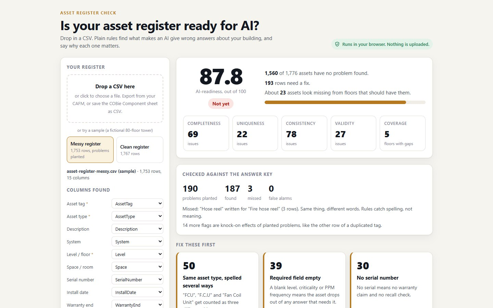

# Asset Register Check

Is your asset register ready for AI? Drop in a CSV. Plain rules find what makes an AI give wrong answers about
your building, and say why each one matters.

**Live:** https://mohdimran32000.github.io/asset-register-check/

It runs in your browser. Your file is read by the page and never sent anywhere.

## Why

I asked an AI (Gemini 3.8 Flash) five questions about a building's asset register, three times each. Then I
asked the same five on a messier copy of the same register.

| Question | Clean register | Messy register |
|---|---|---|
| How many fan coil units are on level L47? | 18, every run | **0**, every run (those rows are missing) |
| Which fire hose reels are on level L33? | both tags | **"none listed"** |
| Serial number of lift 4? | VE23-333576 | **"TBC"** |
| When was PDT-L26-FCU-013 installed, and is it under warranty? | 2023, expired | **"2032-08-13"**, repeated without comment. The warranty answer was right. |
| Which apartment and room is PDT-L04-FCU-007 in? | Apt 403 Living room | It spotted that two rows share the tag and listed both. |

On the clean register it got all five right, every run. On the messy one it got none fully right. It read the
register correctly; the register was wrong. This checker flags all five problems before any AI sees the file.

## What it checks

| Check | Why it matters |
|---|---|
| Rows entered twice | The same asset is counted twice, so every total that includes it is wrong. |
| Two assets, one tag | Ask about one asset and you get the other one's history mixed in. |
| Tag written differently | "pdt-l12-fcu-004" and "PDT-L12-FCU-004 " are not the same tag to a machine. |
| Required field empty | Blank level, criticality or PPM frequency (or "TBC", "N/A", "-"): the asset drops out of answers. |
| No serial number | No warranty claim, no recall check. |
| Same asset type, spelled several ways | "FCU", "F.C.U" and "Fan Coil Unit" get counted as three different things. |
| Filed under the wrong system | A fan coil unit under Plumbing won't come back when you ask about HVAC. |
| Level written another way | "Level 12" and "L12" are two different floors to a machine. |
| Level that may not exist | One asset on a level when every other level has dozens is usually a typo. |
| Dates | Days that don't exist, mixed formats, installs in the future, warranty ending before install. |
| Parent asset not in the register | "What does this unit depend on?" has no answer. |
| Assets missing from a floor | A type found on nearly every floor, missing or thin on one of them. |

It's plain code, no AI. Column names are matched automatically: CAFM exports and the COBie Component sheet both
work. You can fix the mapping on the page.

**The score** is the share of assets with no problem found, out of all assets, counting the assets a floor seems
to be missing. Ready is 98 and above, Close is 90 and above, otherwise Not yet. It's this tool's own rubric, not
an industry standard.

## The sample registers

Both are fictional. They describe an 80-floor tower generated from the rules of
[Procedural Dubai](https://github.com/mohdimran32000/procedural-dubai), with the same counts the app shows:
455 apartments, 1,365 fan coil units, 7 lifts and 160 fire hose reels. On top of those come per-floor sprinkler
valves and sub-main boards, and about 60 plant items under stated rules of thumb. Vendors are generic and the
serial numbers are made up.

- `samples/asset-register-clean.csv`: 1,767 assets. **Scores 100, with zero flags.**
- `samples/asset-register-messy.csv`: the same register with **190 problems planted on purpose**, at random rows
  with a fixed seed. Every one is listed, with its row, in `samples/answer-key.csv`.

On the messy register the checker scores 87.8 ("Not yet"). **It finds 187 of the 190 planted problems, with 0
false alarms.**
- The 3 it misses are "Hose reel" written for "Fire hose reel": same thing, different words. Rules catch
  spelling, not meaning.
- 14 more flags are knock-on effects of planted problems, such as the other row of a duplicated tag.

## Limits

- It finds problems a pattern can show. It can't know that a pump is missing if nothing around it suggests one
  should be there.
- "Assets missing from a floor" needs levels written as codes (L01, L02 ...) and at least 10 typical floors.
- The AI test was one model, one prompt style, three runs per question, on a fictional building.

## Run it locally

Open `index.html` and drop a CSV on it. The sample buttons need the files served, so run
`python -m http.server` in this folder and open http://localhost:8000.

Made by Mohamed Imran with Claude Code (Opus 5.5). MIT licence.
